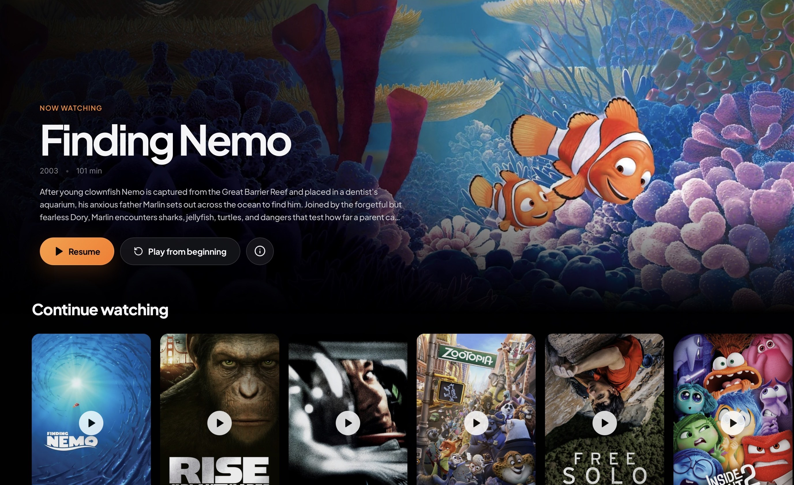
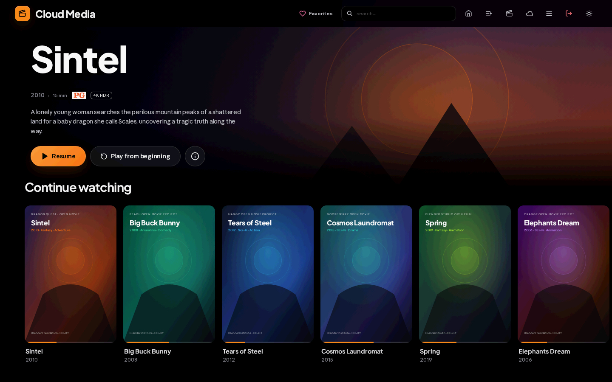
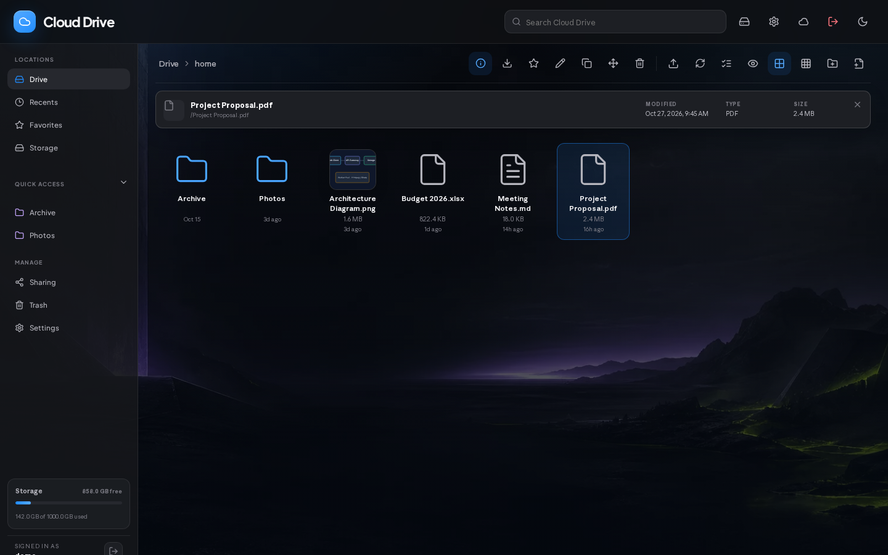
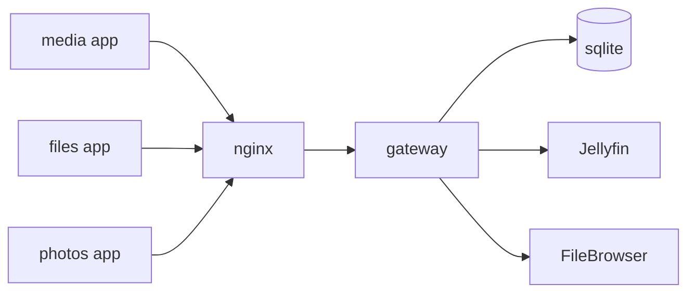

# cloud-at-home

Movies, files and photos on a home server. A media player and a file manager, with a gateway between them and Jellyfin and FileBrowser.



Most of the work went into the player. Browsers disagree about HEVC and surround sound, Apple's player takes over text tracks and fullscreen if you let it, and the stream's clock drifts every time you seek.





The media app and the files app, on demo data.

## How it fits together



Every app talks only to the gateway, a small Flask app in front of Jellyfin and FileBrowser. Nginx serves the apps, sets a strict content security policy, and turns off buffering on the stream route so video is passed on as it arrives.

The browser never holds a Jellyfin or FileBrowser token. The gateway keeps each one encrypted in SQLite and gives the browser an HttpOnly, same-site cookie and a CSRF token. Every request that changes something has to send the token back. Failed sign-ins are rate limited, and only a rejected password counts, so an upstream outage cannot lock anyone out. When an upstream token expires, the gateway clears the cookie and the app drops back to the sign-in screen.

A video stream needs a ticket for that one title. A ticket lasts six hours, and the gateway refuses a stream without a valid one.

Files and Photos are two views of the same folder, and Files can link into Photos. A small shared package holds the theme, the modal, the lightbox and the switcher that moves between the apps. The apps are TypeScript and React 19, built with Vite, and the gateway and the web containers run under Docker Compose. This repository holds selected modules from a private codebase and is not runnable on its own. The gateway, the Nginx config and the Photos app are not part of it.

## The media player

**Subtitles are drawn by the app.** Registering a text track on the video would hand subtitles to the browser, and on Apple devices to AVKit. So the player fetches plain WebVTT from the gateway, parses the cues itself and draws them over the video.

Where the browser allows it, the cue is looked up from the timestamp of the frame on screen, not from `currentTime`. Native HLS can report a transport offset in that timestamp, so the player compares the two on the first frame and keeps whichever clock agrees. A counter ticks on every seek, and a callback queued before the seek is dropped. An old frame cannot put an old cue back on screen ([`apps/media/src/playback.ts`](apps/media/src/playback.ts)):

```ts
export function subtitleFrameTime(currentTime: number, mediaTime: number, clock: "detect" | "decoded" | "dom" = "detect"): number {
  if (!Number.isFinite(mediaTime)) return currentTime;
  if (!Number.isFinite(currentTime)) return mediaTime;
  if (clock === "decoded") return mediaTime;
  if (clock === "dom") return currentTime;
  return Math.abs(mediaTime - currentTime) <= .5 ? mediaTime : currentTime;
}
```

**Subtitles can be nudged.** The subtitle files are usually right to within a tenth of a second. What drifts is the stream. A seek restarts the transcode at the nearest keyframe, while the playlist still labels segments on an even six-second grid. The gap between what you hear and what the timeline says changes with where you seeked. So the nudge is a per-viewing control, in steps of 0.1 s or 0.5 s, and it stays with that player session.

A Save timing button turns the current offset into the title's default for everyone, and only the owner can press it. If someone else saved first, the gateway answers 409 and the player loads their value instead of overwriting it. The default is keyed by a hash of the cue start and end times, not the text, so a translated track with the same cues inherits it ([`apps/media/src/subtitleTiming.ts`](apps/media/src/subtitleTiming.ts)).

**Audio is probed separately from video.** Jellyfin reads the list of audio codecs in a device profile as a preference order. Offer surround audio to every browser that decodes HEVC, and a title whose audio needs re-encoding can come back as AC-3, which the browser may not be able to decode. The player then sits paused with a decode error. So AC-3 and E-AC-3 are checked on their own, and AAC always comes last as the fallback:

```ts
export function audioCodecPreference(audio: AudioCapabilities): string {
  const surround = [audio.eac3 ? "eac3" : "", audio.ac3 ? "ac3" : ""].filter(Boolean);
  return [...surround, "aac"].join(",");
}
```

**Segment sizes follow the source.** Stream copy can only cut on the source's keyframes, so it uses six-second segments. A real transcode can cut every second. Advertise one second for stream copy and Jellyfin counts seeks in one-second segments while the video is cut every six, so one segment number can mean two different positions. The gateway caps every static read at 4 MiB, open-ended ranges included, and direct play of a compatible MP4 is only turned on with that cap.

**The rest of the player.** Volume goes up to 200%. Above 100% the sound passes through a gain stage and a compressor, and the boost has to be switched on by a click each session so the browser does not suspend the audio silently. Scrubbing shows thumbnails from Jellyfin's trickplay sprites. Intros, recaps and credits get a skip button. The stats panel copies as diagnostics, with URLs and tokens redacted. The play clock is an odometer, painted by hand outside React so the two do not fight over the digits.

**Metadata keeps its sources apart.** A rating badge comes from its own authority: British Columbia film classification, Canadian TV, the MPA or US TV. A Canadian rating is never turned into an MPA one. TMDB lists the countries that financed a film, not where it is from, so the US goes first when it is involved.

## The file manager

Text and code open in Monaco. A file up to 5 MiB can be edited, up to 50 MiB it is read-only, and anything larger is download only. Markdown and HTML are sanitized before they preview, and the HTML preview runs in a sandboxed iframe.

**Formatting waits for the language worker.** Monaco loads its TypeScript and JavaScript service late, and a format request before that does nothing and says nothing. The Format button stays disabled until a round trip to the worker succeeds. It retries every 250 ms and gives up after a minute, then enables the button anyway so it never stays dead ([`apps/files/src/Editor.tsx`](apps/files/src/Editor.tsx)).

**Saves send the ETag back.** The editor sends it in `If-Match`. When the server answers 412, the editor says the file changed and to reopen it before saving.

**Batch actions finish what they can.** Copy, move and trash run four at a time. Every item is tried, and the summary says which ones failed. Paths are checked before they go out, so `..` and null bytes are rejected, and a move destination is built from the source's own name. Deleted files go to a trash for 30 days and can be restored. One folder, the media drive, is read-only, and the gateway refuses writes into or out of it. It decodes the path and resolves `..` first, so a crafted path cannot walk around the check.

**The lightbox keeps one key listener.** It reads its callbacks through refs. Swapping a listener in the middle of a key event makes the browser drop that event, and Escape stopped closing the viewer. It is also mounted on the page body, so the top bar cannot paint over its buttons ([`packages/ui/src/lightbox.tsx`](packages/ui/src/lightbox.tsx)).

## What's in this repository

| File | What it does |
| :--- | :--- |
| [`apps/media/src/Player.tsx`](apps/media/src/Player.tsx) | The video player and its settings |
| [`apps/media/src/playback.ts`](apps/media/src/playback.ts) | Device profiles, subtitle parsing and clocks, stats |
| [`apps/media/src/subtitleTiming.ts`](apps/media/src/subtitleTiming.ts) | Subtitle nudges and the saved default |
| [`apps/media/src/mediaMetadata.ts`](apps/media/src/mediaMetadata.ts) | Countries, titles and series years |
| [`apps/media/src/rating.ts`](apps/media/src/rating.ts) | Rating badges |
| [`apps/media/src/rollingTime.ts`](apps/media/src/rollingTime.ts) | The odometer clock |
| [`apps/files/src/Editor.tsx`](apps/files/src/Editor.tsx) | File viewer and Monaco editor |
| [`apps/files/src/file-utils.ts`](apps/files/src/file-utils.ts) | Paths, file types and batch actions |
| [`apps/files/src/api.ts`](apps/files/src/api.ts) | The gateway client |
| [`packages/ui/src/lightbox.tsx`](packages/ui/src/lightbox.tsx) | The shared lightbox |

## License

The source is proprietary.
