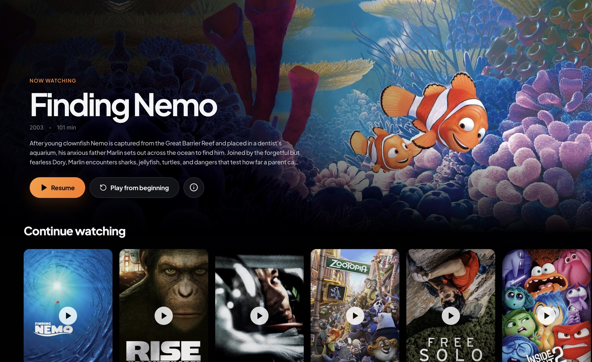
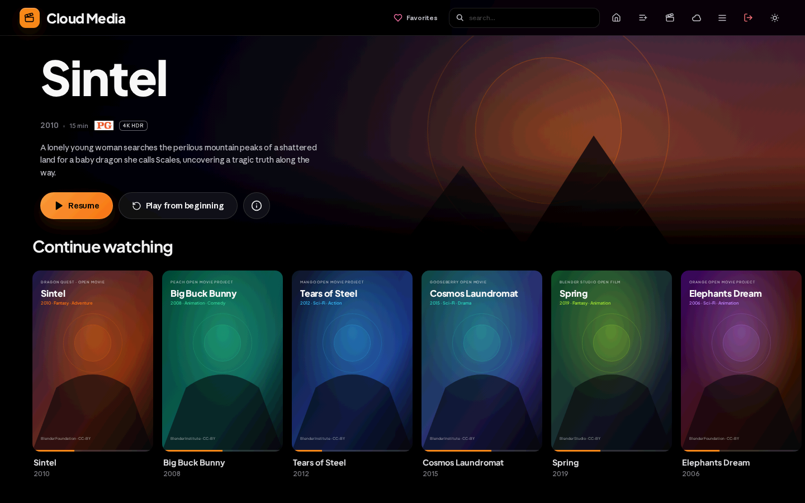
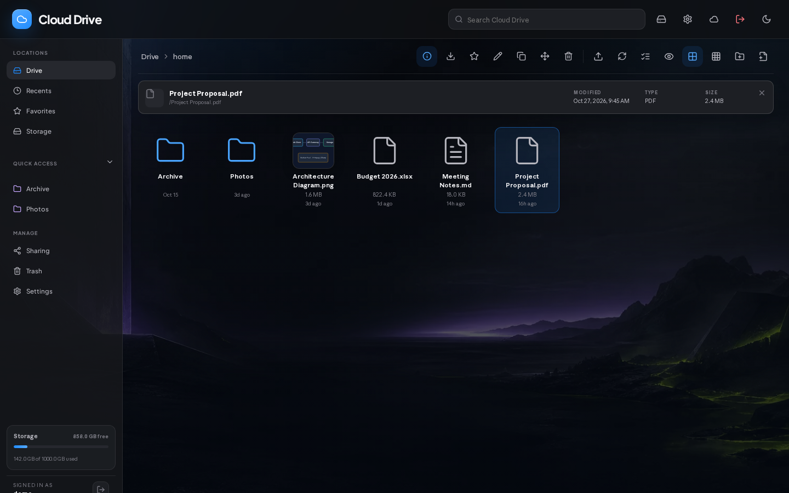

# Cloud at Home

A self-hosted suite for movies and series, files, and photos: four web apps behind one sign-in, running on a home server.



The source is private. This repository holds the README and screenshots.

| Cloud Media | Cloud Files |
| :---: | :---: |
|  |  |

The two screenshots above run on sample content: Blender open movies and placeholder files.

## The apps

- **Portal:** the launcher, with global search, storage and library summaries, and the admin pages.
- **Cloud Media:** movies and series with resume points, subtitles, profiles and recommendations. Files play directly when the browser can handle them, and through HLS transcoding when it can't.
- **Cloud Files:** a drive with folders, previews, chunked uploads, trash, stars, sharing and storage quotas.
- **Cloud Photos:** a date-grouped timeline of photos and videos, with albums, favourites, sharing and a slideshow.

## How it fits together

```
Browser (React 19 + Vite + Tailwind v4)
  ├── /              Portal (app launcher, storage overview, global search)
  ├── /files         Cloud Files (folders, upload, preview, trash, star, share)
  ├── /media         Cloud Media (catalog, detail, HLS/direct player, subtitles)
  └── /photos        Cloud Photos (timeline, albums, favorites, lightbox)
         │
         ▼
Express 5 API
  ├── /api/auth/*    Google OAuth + JWT sessions + invite-based access control
  ├── /api/files/*   Drive CRUD, chunked uploads, streaming, range requests
  ├── /api/media/*   Library scan, FFprobe metadata, HLS transcode, OpenSubtitles
  ├── /api/photos/*  Timeline, albums, EXIF extraction, thumbnail generation
  └── /api/admin/*   Users, invites, storage quotas, media library paths
         │
         ▼
SQLite (WAL mode) + Local Filesystem + FFmpeg / Sharp workers
```

Access is by invitation: sign in with Google, and an admin's invite decides who gets in and how much storage they have.

---

Source code is proprietary.
