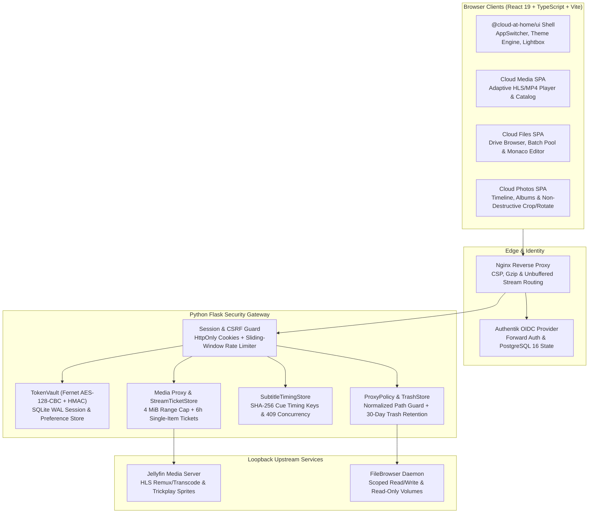

# cloud-at-home

Movies, files and photos on a home server, behind one sign-in.


Three React apps (Media, Files and Photos) share one shell and one sign-in. A small Python gateway sits in front of Jellyfin and FileBrowser, so the browser never sees an upstream credential, a filesystem path or an unauthenticated media URL. Most of the interesting work is in the browser's media pipeline: HEVC and surround sound decode differently across browsers, iOS takes over text tracks, and stream clocks drift.

## Highlights

- Subtitles are timed against the decoded video frame (`requestVideoFrameCallback`), and a seek epoch stops a late frame from repainting a cue from before the seek.
- Video and audio capability are probed separately, so a browser that plays HEVC but not E-AC-3 still gets the right stream. Direct playback is served in bounded 4 MiB ranges.
- A dialogue mode routes the video element through a Web Audio compressor and gain stage, with a volume boost up to 200%.
- Subtitle timing nudges are kept per session and published deliberately. Timing is keyed by a hash of the cue timestamps, so a translated track inherits the offset, and conflicting edits resolve with HTTP 409.
- Files opens text and code in Monaco, waits until the language worker is actually ready before formatting, and saves with `ETag` / `If-Match`, so two tabs cannot overwrite each other.
- The gateway keeps upstream tokens encrypted, checks a CSRF token on every state-changing request, and issues six-hour single-item tickets for native players such as AirPlay.

## Screenshots


## Architecture



All browser traffic enters through an Nginx edge proxy that sets strict Content Security Policy headers and disables request and response buffering on `/api/media/stream/` routes. The Python Flask gateway terminates application sessions using `HttpOnly`, `SameSite=Lax` cookies backed by SQLite in `WAL` mode; upstream Jellyfin and FileBrowser access tokens never reach the browser and are persisted only as Fernet ciphertext in the `sessions` table. Media playback requests either use short-lived, single-item stream tickets (6-hour TTL) for native HLS/AirPlay handoff or pass through a byte-range normalizer that caps every static read at 4 MiB. File and photo mutations pass through `ProxyPolicy`, which URL-decodes and normalizes relative path segments to block writes touching mounted read-only roots before forwarding requests to FileBrowser.

## Inside this repository

| Module | Lines | Responsibility |
| --- | ---: | --- |
| [`apps/media/src/Player.tsx`](apps/media/src/Player.tsx) | 2,065 | Adaptive HLS and bounded direct-play video player with `requestVideoFrameCallback` subtitle clock sync, Web Audio 200% boost and dynamics compressor, rAF-coalesced scrubbing with trickplay thumbnails, pause-cinema handoff, and live buffer telemetry. |
| [`apps/media/src/playback.ts`](apps/media/src/playback.ts) | 872 | Playback domain logic: separate HEVC video vs. AC-3/E-AC-3 surround audio capability profiles, conservative WebVTT parser, decoded-frame vs. DOM clock domain selection, CJK/English subtitle stream curation, and sanitized diagnostic export. |
| [`apps/media/src/subtitleTiming.ts`](apps/media/src/subtitleTiming.ts) | 156 | Stateful `SubtitleTimingController` managing live per-session subtitle timing nudges (`±0.1 s` / `±0.5 s`), SHA-256 content-key fallback, and optimistic-concurrency default publication with `409 Conflict` recovery. |
| [`apps/media/src/mediaMetadata.ts`](apps/media/src/mediaMetadata.ts) | 189 | Catalog metadata normalization: co-production financing country deduplication with US-first pill ordering, CJK original-title script detection, logo-aware secondary title suppression, and IMDb/Tomatometer canonical link resolution. |
| [`apps/media/src/rating.ts`](apps/media/src/rating.ts) | 107 | Multi-jurisdiction content classification engine mapping British Columbia Film Classification (`G`, `PG`, `14A`, `18A`, `R`, `A`), CBSC (`14+`, `18+`), MPA, and US TV Parental Guidelines into badge shapes and regulatory advisories without cross-country tier synthesis. |
| [`apps/media/src/rollingTime.ts`](apps/media/src/rollingTime.ts) | 75 | Imperative DOM odometer renderer (`paintRollingTime`) that reconciles right-aligned place-value digit cells across duration length transitions (`0:59` to `1:00:00`) outside React reconciliation. |
| [`apps/files/src/Editor.tsx`](apps/files/src/Editor.tsx) | 189 | Document viewer and Monaco code editor with a TypeScript/JavaScript Web Worker syntactic-diagnostics readiness probe, `ETag`/`If-Match` concurrency control, and `sanitize-html` + `marked` Markdown/HTML preview. |
| [`apps/files/src/file-utils.ts`](apps/files/src/file-utils.ts) | 196 | Filesystem and batch utilities: path-traversal-safe path joiner, virtual-collection mutation destination builder, bounded-concurrency batch worker pool (`BATCH_CONCURRENCY = 4`), and file-size editor mode tiering. |
| [`apps/files/src/api.ts`](apps/files/src/api.ts) | 229 | Typed Cloud Files HTTP client with automatic `X-CSRF-Token` injection on state-changing methods, mid-session `401` interception, `ETag`/`If-Match` text save protocol, `XMLHttpRequest` upload progress streaming, and in-flight folder-size request deduplication. |
| [`packages/ui/src/lightbox.tsx`](packages/ui/src/lightbox.tsx) | 122 | Portal-mounted media lightbox shared across Cloud Files and Cloud Photos with cyclic modulo navigation and a ref-backed single-registration `keydown` listener that avoids mid-dispatch listener teardown. |

This repository contains selected source modules from a private production codebase and is not runnable as a standalone application.

## How it works

### 1. Decoded-frame subtitle synchronization and seek-epoch fencing

Registering native `<track>` elements on an HTML5 `<video>` node hands subtitle rendering to the browser's media engine (and to AVKit on iOS/macOS), which overrides custom typography and breaks live timing adjustments. Cloud Media instead fetches normalized WebVTT from the gateway, parses cues into plain intervals, and drives cue lookup from `requestVideoFrameCallback`. Because native MPEG-TS HLS streams can expose a raw transport PCR offset in `metadata.mediaTime`, `subtitleFrameTime` compares the first owned frame against `video.currentTime` within a `0.5 s` window to lock onto either the decoded-frame clock or the DOM clock, while `subtitleClockEpochRef` discards callbacks queued prior to a seek:

```ts
// apps/media/src/playback.ts
export function subtitleFrameTime(currentTime: number, mediaTime: number, clock: "detect" | "decoded" | "dom" = "detect"): number {
  if (!Number.isFinite(mediaTime)) return currentTime;
  if (!Number.isFinite(currentTime)) return mediaTime;
  if (clock === "decoded") return mediaTime;
  if (clock === "dom") return currentTime;
  return Math.abs(mediaTime - currentTime) <= .5 ? mediaTime : currentTime;
}

// apps/media/src/Player.tsx
const syncSubtitleCue = useCallback((mediaTime?: number, clockSource: "DOM currentTime" | "Decoded frame timestamp" = "DOM currentTime", clockEpoch = subtitleClockEpochRef.current) => {
  if (clockEpoch !== subtitleClockEpochRef.current || mediaSeekingRef.current || seekingRef.current) return;
  const seconds = mediaTime ?? videoRef.current?.currentTime ?? positionRef.current;
  subtitleClockRef.current = { seconds, source: clockSource };
  const nextCue = mediaCueTextAt(subtitleCuesRef.current, seconds - subtitleDelayRef.current);
  if (nextCue === cueRef.current) return;
  cueRef.current = nextCue;
  setCue(nextCue);
}, []);
```

### 2. Decoupled HEVC and surround-audio capability probing

Jellyfin interprets `AudioCodec` in a `DeviceProfile` as a strict preference order when transcoding unsupported audio tracks such as DTS. Advertising `"eac3,ac3,aac"` whenever a browser supports HEVC (`hvc1`) video causes Jellyfin to transcode DTS into AC-3 on desktop browsers that decode HEVC in hardware but lack Dolby audio decoders, stalling playback with `MEDIA_ERR_DECODE`. `webPlaybackProfileFor` probes AC-3 and E-AC-3 independently of HEVC and separates 6-second keyframe-aligned stream-copy HLS segments from 1-second re-encoded HLS segments:

```ts
// apps/media/src/playback.ts
export function audioCodecPreference(audio: AudioCapabilities): string {
  const surround = [audio.eac3 ? "eac3" : "", audio.ac3 ? "ac3" : ""].filter(Boolean);
  return [...surround, "aac"].join(",");
}

export function webPlaybackProfileFor(supportsHevc: boolean, audio: AudioCapabilities = {}, acceleratedTranscode = false) {
  if (!supportsHevc) {
    if (!acceleratedTranscode) return webPlaybackProfile;
    return {
      ...webPlaybackProfile,
      Name: "Cloud Media Web Transcode",
      TranscodingProfiles: webPlaybackProfile.TranscodingProfiles.map((profile) => ({
        ...profile,
        SegmentLength: 1,
        BreakOnNonKeyFrames: true,
      })),
    };
  }
  const audioCodecs = audioCodecPreference(audio);
  const hasSurround = audioCodecs !== "aac";
```

### 3. Monaco Web Worker readiness probing and ETag-guarded saves

In `@monaco-editor/react`, the editor instance mounts and registers the `editor.action.formatDocument` action before the background TypeScript/JavaScript Web Worker finishes initializing its language service, causing early format invocations to silently no-op. `FileViewer` polls `getSyntacticDiagnostics` on the active model URI every `250 ms` (up to `60 s`) before enabling the Format button, and pairs saves with `ETag`/`If-Match` headers so concurrent modifications surface as HTTP `412 Precondition Failed` instead of overwriting newer file state:

```tsx
// apps/files/src/Editor.tsx
const waitForWorker = async () => {
  const getWorker = language === "typescript"
    ? monaco.languages.typescript.getTypeScriptWorker
    : monaco.languages.typescript.getJavaScriptWorker;
  const deadline = Date.now() + 60_000;
  while (!cancelled && Date.now() < deadline) {
    try {
      const worker = await getWorker();
      const client = await worker(model.uri);
      await client.getSyntacticDiagnostics(model.uri.toString());
      if (!cancelled) setFormatterReady(true);
      return;
    } catch {
      await new Promise((resolve) => window.setTimeout(resolve, 250));
    }
  }
};
```

## Stack

| Layer | Technologies |
| --- | --- |
| Front-End Applications | React 19, TypeScript 5.8, Vite 6, Motion (`motion/react`), Radix UI (`@radix-ui/react-dropdown-menu`), Lucide icons, `hls.js` (lazy-loaded on browsers without native HLS), `@monaco-editor/react`, `marked`, `sanitize-html` |
| Security Gateway | Python 3, Flask, SQLite 3 (`WAL` mode), `cryptography` (Fernet symmetric encryption), `requests` |
| Edge & Upstream Infrastructure | Nginx, Authentik OIDC (PostgreSQL 16), Jellyfin, FileBrowser, Docker Compose, systemd |

## License

Source code is proprietary.
